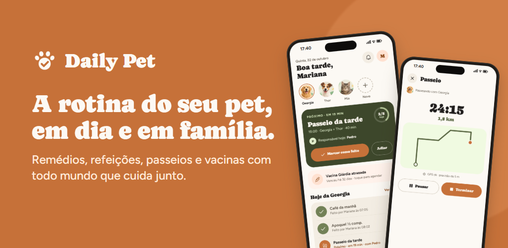
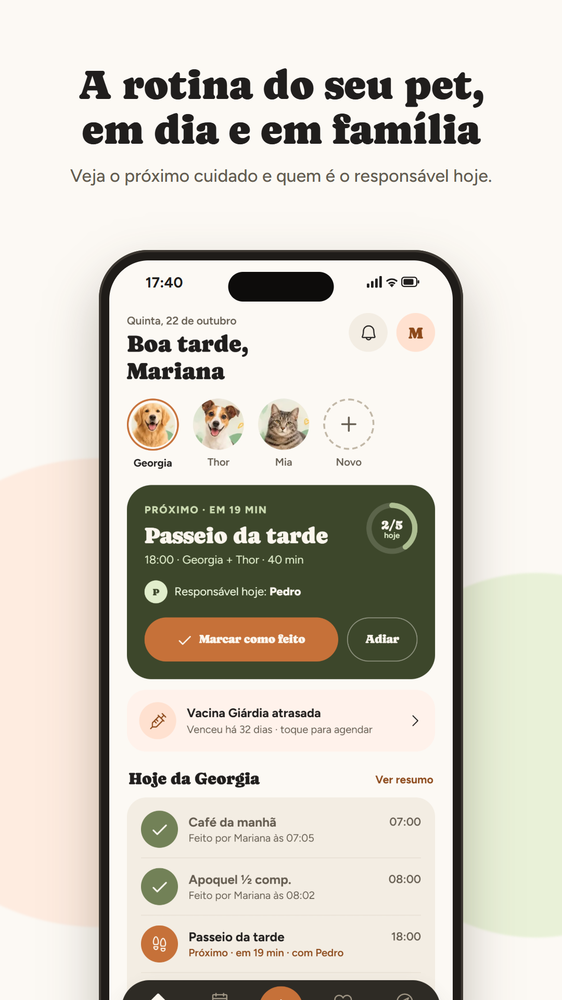
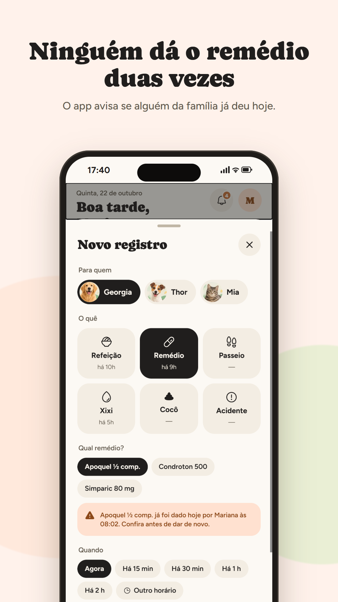
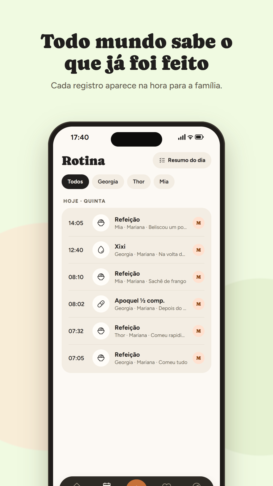
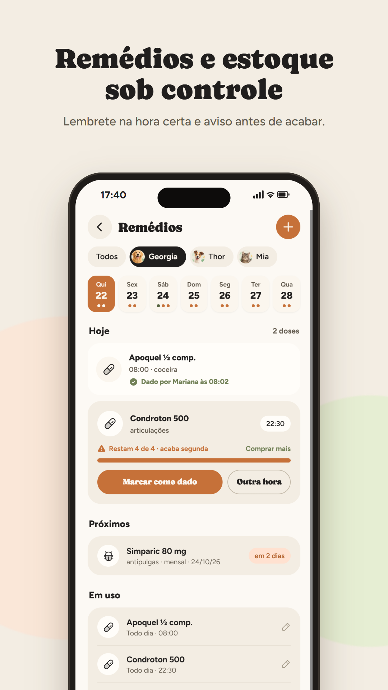
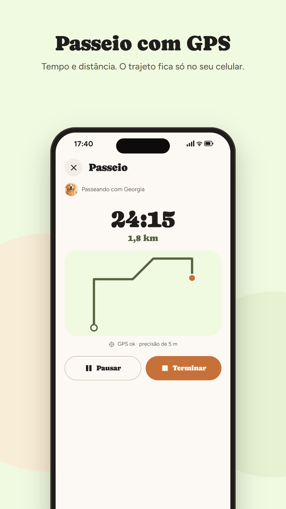
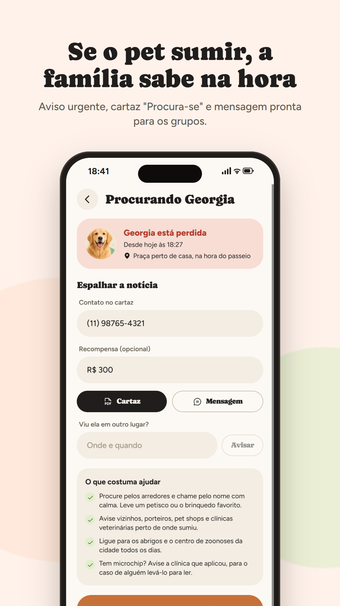
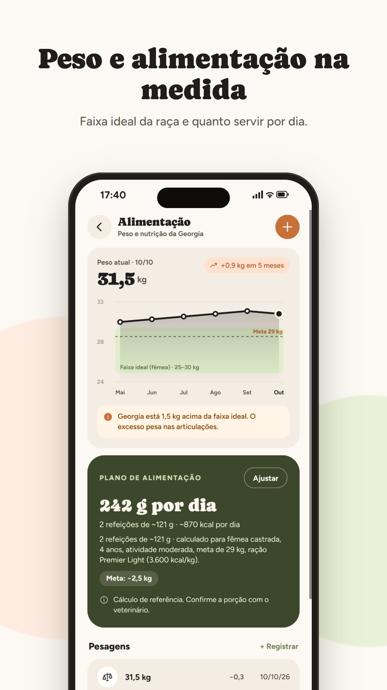
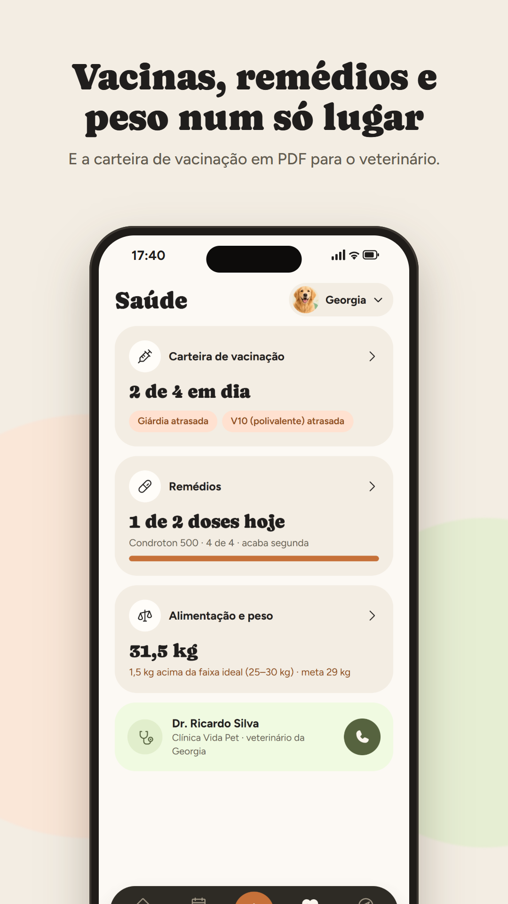
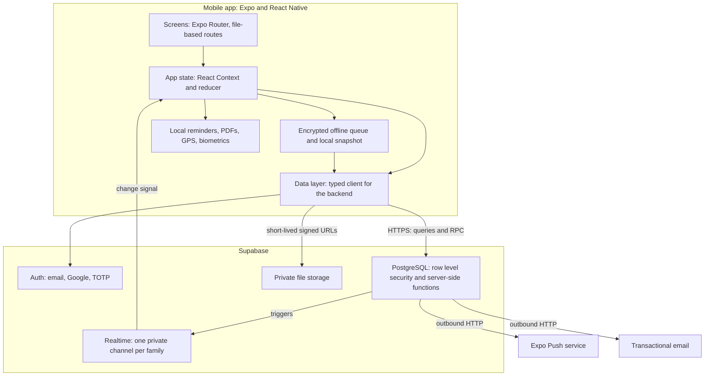

# DailyPet

A mobile app that keeps a pet's daily care in sync across everyone who looks after it: meals, walks, medications, vaccines and weight, with each person seeing in real time what has already been done.

## Status

DailyPet is in active development. The Android release on Google Play is coming soon, with iOS to follow. The app's interface is in Brazilian Portuguese.

The source code is kept in a private repository. It is available on request for hiring processes.

## Screenshots

<table>
  <tr>
    <td></td>
    <td></td>
    <td></td>
    <td></td>
  </tr>
  <tr>
    <td></td>
    <td></td>
    <td></td>
    <td></td>
  </tr>
</table>

All screenshots use a demo account with fictional data.

## Features

**Daily routine**
- Pet profiles and a daily routine with times and a person responsible for each task.
- One-tap records for meals, walks, bathroom breaks, accidents and medications, with time correction and an "edited" mark.
- Home screen built around the next care task and the day's progress; daily summary per pet.
- Complete pet history from the first record, loaded page by page and filterable by type.

**Family**
- Invitations by code shared over WhatsApp. Codes expire after 7 days.
- Two roles: family members, who can also change the routine, and caregivers, who can only record what the owner allows.
- Changes made on one phone show up on the others within seconds, with no manual refresh.

**Health**
- Medications on fixed times or every N days, stock tracking with a low-stock warning, and a warning when someone in the family already gave today's dose.
- Vaccination card with due-date warnings, exportable as PDF.
- Weight tracking against the ideal range for the breed and sex, and a daily feeding plan in calories and grams.
- Weekly report as PDF for the vet: meals, walks, medications, accidents and notes.

**Reminders and offline use**
- Local reminders scheduled on the device for the next seven days, with optional quiet hours at night.
- Records made without a connection are kept on the device, encrypted, and sent automatically when the connection returns. The app opens from a local copy of the data.

**Extras**
- GPS walk: time, distance and a drawing of the route. The route never leaves the phone; only duration and distance are stored.
- Lost pet mode: an urgent alert for the whole family, a "missing" poster as PDF with photo and contact, and a ready-to-share message.
- Nearby vets from OpenStreetMap (open now and 24-hour filters) and care tips based on species, breed, age and health history.

**Account and security**
- Two-step verification (TOTP) with recovery codes, biometric app lock, list of signed-in devices with remote sign-out, and new sign-in alerts in the app and by email.
- Self-service data export and account deletion, in line with Brazil's data protection law (LGPD).

**Plans**
- Free and Premium plans at the household level, so one subscription covers the whole family. Plan limits are enforced by the database and are currently switched off until in-app billing is live.

## Architecture

- **Navigation.** File-based routes with Expo Router, typed routes and route groups protected by session state and by the second authentication step.
- **State.** A single store built on React Context and a reducer. Screens read from it and call actions; the data layer is the only part that talks to the backend.
- **Offline first.** Records get client-generated IDs and are written with idempotent upserts, so a record sent twice after a dropped connection is stored once. A queue coalesces pending changes (an edit to a record that was never sent updates the queued record instead of adding a step), and the last snapshot of the data is cached on the device so the app opens without a connection.
- **Family sync.** Database triggers publish a lightweight "something changed" signal on a private channel per family. The signal carries no data; clients refetch through the normal, permission-checked queries.
- **Server-side logic in Postgres.** There are no separate backend services. Sensitive operations run as database functions, and outbound calls (push notifications and security emails) are made from the database through an HTTP extension, with secrets kept in the database vault.
- **Notifications.** Routine reminders are scheduled locally, so they work without a connection. Family notices are sent by the server when a record is created, respecting each person's preferences and quiet hours in the device's time zone.

## Security

The design assumes the client can be bypassed, so every rule that matters lives in the database.

- **Row level security everywhere.** Every table has row level security enabled. Access is scoped to the families a person belongs to, and personal items, such as security notices, are visible only to their owner. Caregivers can only record the types of care the family owner allowed.
- **Least-privilege writes.** On top of the policies, privileges are granted per column: the app can write only the fields a person is meant to edit, and fields such as authorship, audit timestamps and plan status can only be set by the server.
- **Two-step verification enforced by the database.** When a person enables TOTP, a restrictive policy on the core tables and on photo storage requires a fully verified session (AAL2). Skipping the second step in the app opens nothing on the server. Recovery codes are stored only as bcrypt hashes.
- **Encrypted sensitive fields.** Microchip numbers and phone numbers are encrypted at rest, with the key held in the database vault. The family sees only the last four digits of a microchip.
- **Hardened functions.** Server-side functions run with an empty search path, validate their input and apply attempt limits to passwords, recovery codes and invitation codes. Invitation codes are stored only as hashes.
- **Session control.** People can see their signed-in devices, sign any of them out remotely and get an alert on every new sign-in. Push notification addresses are tied to the sign-in session, so a device stops receiving family notices as soon as it is signed out.
- **On the device.** The session and the offline queue are encrypted, with keys kept in the operating system's secure storage. An optional biometric lock protects the app.
- **Privacy by design.** The GPS route stays on the phone, the vet search sends only an approximate area, photos are served through short-lived signed links, and the error log stores technical details only, never pet or family data.

## Testing and CI

| Layer | What | Size |
|---|---|---|
| Database | SQL suites run against the backend with throwaway accounts that are removed at the end (most suites run inside a transaction that is rolled back) | 8 suites, 159 checks |
| End to end | Real user flows driven with puppeteer-core against the app's web build, using a demo account | 9 flows, 77 checks |
| CI | GitHub Actions on pushes to main and on pull requests | Type check, lint, Expo diagnostics |

- **Database suites** try to break the access rules from the outside, for example by reading another family's data, writing server-managed fields or skipping the second authentication step. They also cover family invitations, realtime channel authorization, push notification targeting and quiet hours, plan limits, the GPS walk and lost pet alerts. The security suite alone has 88 checks.
- **End-to-end flows** cover editing and correcting records, daily progress, sync between two sessions, recording offline and reconnecting, reminder planning, plan limits and the Premium promotion, a GPS walk with simulated location, the lost pet flow and the health screens. Flows that create data do it through the interface and delete it through the interface at the end.
- **CI** installs from the lockfile and runs the TypeScript compiler in strict mode, ESLint with the Expo configuration and `expo-doctor`.
- The database and end-to-end suites run locally, because they need a live backend and a demo account; CI covers the static checks. There is no unit test suite yet.

## Tech stack

| Area | Technology |
|---|---|
| Mobile | Expo SDK 58, React Native 0.88, React 19.3, TypeScript 6.0 (strict) |
| Navigation | Expo Router 58 with typed routes |
| UI | React Compiler, Reanimated 4, react-native-svg, expo-image, Phosphor icons |
| Device features | expo-notifications, expo-location, expo-secure-store, expo-local-authentication, expo-print |
| Backend | Supabase: PostgreSQL 17, Auth with TOTP, Storage, Realtime |
| Database extensions | pgcrypto, pg_net, Vault |
| Client library | supabase-js 2 |
| Testing | SQL test suites, puppeteer-core 25 |
| Tooling | GitHub Actions, ESLint, EAS Build |

## What I learned

- **Putting authorization in the database.** Combining row level security with a restrictive policy for two-step verification and column-level privileges means a modified client still cannot read or write what it should not. Writing adversarial SQL tests that try to break those rules was the only way to trust them.
- **Offline first needs idempotency.** Client-generated IDs plus upserts that ignore duplicates made retries safe. Coalescing the queue kept edits and deletions of unsent records consistent, and encrypting the local copy kept offline use from becoming a privacy gap.
- **Realtime without leaking data.** Sending only a change signal on a private, permission-checked channel and letting clients refetch through their normal queries kept the access rules in one place instead of duplicating them in the realtime layer.
- **Notifications from Postgres.** Triggers that call the push service through an HTTP extension removed the need for a separate backend. The harder part was the policy around it: per-person preferences, quiet hours in each device's time zone, urgent alerts that skip both, and cleaning up addresses the push service reports as gone.
- **Major framework upgrades.** Moving from Expo SDK 57 to 58 changed how protected routes redirect, tightened React Native's types and closed internal package paths. The end-to-end suite caught the regressions before they reached a phone.

## Contact

- Portfolio: [marianalimadev.com](https://marianalimadev.com)
- LinkedIn: [linkedin.com/in/marianawlima](https://linkedin.com/in/marianawlima)
